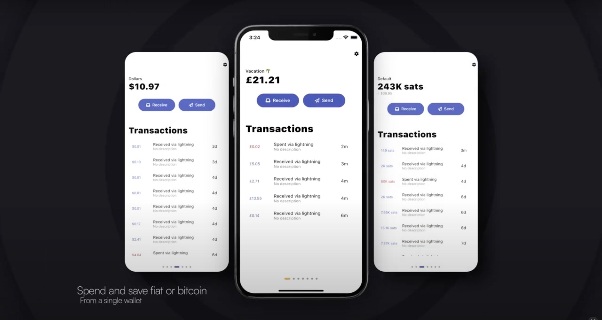

# Sudonym

Sudonym is a white-label Bitcoin and Lightning wallet built as a Flutter mobile application with a NestJS API, shared TypeScript/Dart models, and Google Cloud infrastructure.

<p align="center">
  
</p>

> [!NOTE]
> This is a historical codebase from 2022–2023. It targets Node.js 18, NestJS 9, Dart 2.18, and the corresponding Flutter generation. Use an isolated legacy toolchain to reproduce it, and upgrade its dependencies and infrastructure before operating it with real funds or personal data.

## Architecture

```text
.
├── api             # NestJS REST/WebSocket backend
├── app             # Flutter wallet for iOS and Android
├── models          # Shared TypeScript and generated Dart models
├── infrastructure  # GCP, Kubernetes, Docker, and minikube tooling
└── homepage        # Historical product landing page
```

The product includes account and pot balances, Lightning and on-chain payments, LNURL flows, contacts, bill splitting, BOLT card support, notifications, and app-store build pipelines.

## Getting Started

### Prerequisites

- Node.js 18 and npm 8
- A Flutter SDK compatible with Dart `>=2.18.0 <3.0.0`
- Docker and MySQL 8 for local API development
- A Firebase project plus the Firebase and FlutterFire CLIs for the app
- Google Cloud CLI, kubectl, and minikube only for the full infrastructure workflow

### Clone and install

```bash
git clone https://github.com/sudonym-btc/sudonym.git
cd sudonym
npm install
```

The historical `install.sh` installs system tools and starts interactive Google Cloud configuration. Review it before running it; it is not required for the smaller local workflows below.

### Run the Flutter app with mock data

Generate local Firebase configuration first. The generated files are intentionally ignored by Git.

```bash
cd app
flutter pub get
dart pub global activate flutterfire_cli
flutterfire configure
flutter run -t lib/main_mock.dart
```

Sentry and Twitter authentication are disabled unless their build-time values are provided. Client applications cannot safely conceal provider secrets, so use only credentials intended for a public/mobile client and prefer a server-side OAuth exchange for production.

### Run the API locally

Start a disposable MySQL database:

```bash
docker run --name sudonym-mysql \
  -e MYSQL_DATABASE=app \
  -e MYSQL_ALLOW_EMPTY_PASSWORD=yes \
  -p 3306:3306 \
  -d mysql:8
```

Create the ignored local configuration:

```bash
cp api/src/config/.env.example api/src/config/.env
```

Set a unique `JWT_SECRET` and adjust the database values, then start NestJS:

```bash
NODE_ENV=development npm --workspace api run start:dev
```

The API listens on [http://localhost:3000](http://localhost:3000), with Swagger UI at [http://localhost:3000/api](http://localhost:3000/api).

### Configuration

| Setting | Used by | Purpose |
| --- | --- | --- |
| `DB_HOST`, `DB_USER`, `DB_PASS`, `DB_NAME` | API | MySQL connection |
| `JWT_SECRET` | API | JWT signing; required outside tests |
| `SENTRY_DSN` | API and app | Optional error reporting |
| `TWITTER_API_KEY`, `TWITTER_API_SECRET_KEY`, `TWITTER_REDIRECT_URI` | App | Legacy Twitter login configuration |

Pass app values with Flutter's `--dart-define`, for example `--dart-define=SENTRY_DSN=...`. Never commit populated environment, Firebase, service-account, signing, or provider-credential files.

## Commands

| Command | Purpose |
| --- | --- |
| `npm run deploy:development` | Build the historical minikube development stack |
| `npm run deploy:development:hard` | Recreate the stack and initialize Lightning; destructive to local state |
| `npm run watch:api` | Synchronize and follow the API running in minikube |
| `npm run lint` | Lint TypeScript workspaces |
| `npm --workspace api run build` | Compile the NestJS API |
| `npm --workspace api test` | Run API tests against the disposable MySQL container |
| `flutter run -t app/lib/main_mock.dart` | Run the app with mock repositories from the repository root |

## Infrastructure

The `infrastructure/` directory preserves the original GCP, Kubernetes, Cloud Build, Bitcoin Core, and Core Lightning deployment. Some scripts create or delete cloud and local resources. Review project IDs, IAM roles, storage buckets, cluster settings, and costs before running any deployment command.

## Security

This repository handles wallet, authentication, and payment code. It is not an audited wallet release. Do not use it with meaningful funds without a current dependency review, threat model, and independent security audit. See [SECURITY.md](SECURITY.md) for configuration and disclosure guidance.

## License

Licensed under the [ISC License](LICENSE).
